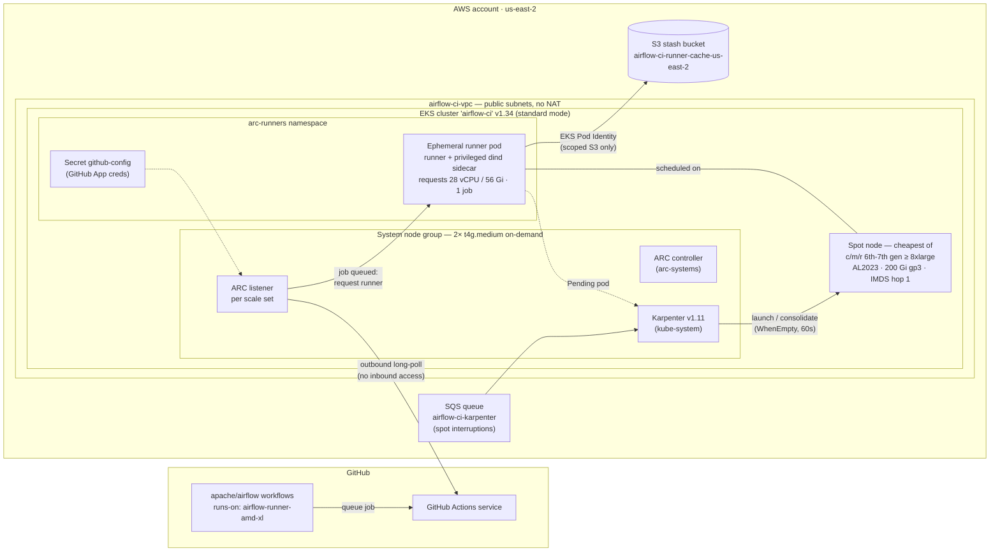

<!--
 Licensed to the Apache Software Foundation (ASF) under one
 or more contributor license agreements.  See the NOTICE file
 distributed with this work for additional information
 regarding copyright ownership.  The ASF licenses this file
 to you under the Apache License, Version 2.0 (the
 "License"); you may not use this file except in compliance
 with the License.  You may obtain a copy of the License at

   http://www.apache.org/licenses/LICENSE-2.0

 Unless required by applicable law or agreed to in writing,
 software distributed under the License is distributed on an
 "AS IS" BASIS, WITHOUT WARRANTIES OR CONDITIONS OF ANY
 KIND, either express or implied.  See the License for the
 specific language governing permissions and limitations
 under the License.
-->

# EKS-based GitHub Actions runners for Airflow CI — architecture

*Status: proposal (2026-07). Supersedes the 2023/2024 design on this branch (PR #59).
All versions and prices below were checked against official sources on 2026-07-25.*

## Why this exists

Airflow's canary/scheduled CI competes for the shared ASF GitHub Actions concurrency
pool. An earlier managed-runner experiment (June–July 2026) proved the mechanics
work but the economics don't: a full "Tests (AMD)" run cost **≈$104**
(1,300 build-minutes on 36 vCPU machines at $0.0798/min), ≈$135k+/yr for scheduled
runs alone — far beyond the ~$15k/yr CI budget envelope. Measured per-job utilization
shows a **7.3× oversizing waste** (median job peaks at ~3 vCPU / 2.3 GiB on a
36 vCPU / 72 GiB box) on top of that service's ~6.6× per-vCPU price premium over EC2 spot.
EKS + spot brings the same run to **≈$7–13**.

## Architecture at a glance

Terraform (`terraform/eks/`) creates everything under **AWS**; helmfile
(`helm/infra-helmfile.yaml`, `helm/ci-helmfile.yaml.gotmpl`) deploys everything inside
**EKS**; the `github-config` secret is created once by hand at bootstrap.

- **Terraform** (this repo, `terraform/eks/`): VPC, EKS cluster, system node group,
  Karpenter controller IAM (Pod Identity), node IAM role, spot-interruption SQS queue.
- **Helmfile** (this repo, `helm/`): Karpenter, ARC controller, runner scale sets,
  Karpenter `NodePool`/`EC2NodeClass` CRs, namespaces.
- **Airflow repo**: `runs-on: airflow-runner-amd-xl` on the Tests (AMD) job graph
  (experiment branch; later behind the existing `selective_checks` runner seam for
  canary-only routing).

## Key decisions (and what was rejected)

### EKS standard mode + self-managed Karpenter — not EKS Auto Mode

Auto Mode was seriously considered (it removes Karpenter/AMI/addon management) and
rejected for this workload:

- Auto Mode nodes are locked-down Bottlerocket: SELinux enforcing, immutable root FS,
  no SSH/SSM. CI runners are privileged docker-in-docker pods that run KinD
  (Kubernetes-in-Docker-in-Docker) and need node sysctls (`fs.inotify.*`,
  `nf_conntrack`, `fs.nr_open`) — exactly the class of workload that fights a locked
  host. Standard AL2023 nodes with our own user data are the proven path.
- Auto Mode adds a per-instance management fee (~10–12% of the instance price) on a
  budget-constrained, compute-dominated bill.
- We already need Helm/CRD management for ARC; Karpenter via the same helmfile is
  marginal extra complexity.

### Karpenter v1.11 — not cluster-autoscaler + 6 static node groups

The previous design (this branch pre-rebase) used six per-size/arch managed node
groups, ASG label/taint tags for scale-from-zero (`asg_tags.tf`), and
cluster-autoscaler. Karpenter replaces all of it:

- Spot-price-aware instance selection across families (the "instance diversity"
  discussion in PR #59 becomes a one-line requirement list).
- Scale-from-zero without ASG tag gymnastics → `asg_tags.tf` deleted.
- Consolidation and native spot-interruption handling (SQS) built in.
- One `NodePool` instead of N node groups; an ARM pool later is ~10 lines.

### ARC runner scale sets 0.14.x — still the supported approach in 2026

`gha-runner-scale-set` (Autoscaling Runner Scale Sets mode) remains GitHub's
maintained ARC mode (latest chart 0.14.2, 2026-05). Ephemeral runners, JIT
registration, no cert-manager/webhook dependency (that was legacy ARC). Auth via a
**GitHub App** (recommended over PAT): for repo-level runners it needs
*Administration: R/W* + *Metadata: R*; for org-level, *Self-hosted runners: R/W*.

### Utilities: what's in, what's out

| Utility | Verdict | Why |
|---|---|---|
| Karpenter | **In** | Node autoscaling; replaces CA + static node groups; spot handling. Cost: negligible (runs on system nodes). |
| ARC (scale sets) | **In** | The runner integration itself. |
| metrics-server | **Out** | ARC scales on the job queue, not resource metrics; no HPA anywhere. Add only if we later want `kubectl top`. |
| cert-manager | **Out** (removed from branch) | Only legacy-mode ARC needed it for admission webhooks. Scale-set mode doesn't. |
| EBS CSI driver | **Out** (removed from branch) | No PersistentVolumes: runner work dirs + dind storage are node-local ephemeral (200 GiB gp3 root via `EC2NodeClass`). |
| cluster-autoscaler | **Out** (replaced) | See Karpenter. |
| External Secrets Operator | **Out** | Exactly one static secret (GitHub App key). ESO adds a controller + still needs a backing store + IAM. `kubectl create secret` at bootstrap is simpler and rotated rarely. Revisit if secrets multiply. |
| AWS Load Balancer Controller | **Out** | Nothing is exposed; ARC listeners do outbound long-poll only. No Service/Ingress of type LB. |

### Networking: public subnets, no NAT — kept deliberately

Nodes launch in public subnets with public IPs (as in the original PR, which removed
the NAT gateway). A NAT gateway costs ~$395/yr + data processing; public IPv4 on
ephemeral nodes costs $0.005/h only while nodes exist (≈$40/yr at our duty cycle).
Security posture is acceptable because: security groups allow no inbound; runners
only make outbound calls (GitHub long-poll, image pulls); nodes use IMDSv2 with hop
limit 1, so **pods (i.e. CI jobs) cannot reach node IAM credentials**; and the
node role carries only EKS/ECR/CNI policies.

### Compute: one runner class now, right-sizing later

Measured mix of a full Tests (AMD) run (duration-weighted minutes by required vCPU
class): `2:787, 4:209, 8:179, 16:96, 32:22, 48:6`. The cost-optimal design is 2–3
scale-set size classes, but that requires per-job `runs-on` routing in the Airflow
repo. To keep the Airflow diff minimal for the experiment, we start with a **single
class sized so no job regresses** vs the previous baseline (32+ vCPU nodes):

- Scale set `airflow-runner-amd-xl`: requests **28 vCPU / 56 Gi** → Karpenter picks
  the cheapest current-gen ≥8xlarge (c6a/c7a/m6a/m7a/r6a/r7a, 32 vCPU) spot node;
  one runner pod per node (requests-based, no anti-affinity hack).
- Spot first with automatic on-demand fallback (`capacity-type: [spot, on-demand]`).
  Consolidation is `WhenEmpty` only — running jobs are never evicted to repack.
- maxRunners 100 (measured burst peak: 77 concurrent on the reduced run, ~163 on a
  full canary; raise when canary-scale traffic is routed here).

Cost at measured volume: ~21.7 node-hours per full run × ~$0.55–0.60/h (8xlarge
spot) ≈ **$12–13/run** vs $104 before — before phase-2 right-sizing, which
takes it to ~$4–5.

**ARM later: yes, worth it.** Graviton spot is 10–25% cheaper per vCPU and the ARM
canary exists. It's one extra `NodePool` (arch: arm64) + one scale set + an ARM
runner image tag. Deliberately out of scope until AMD is proven.

### dind configuration carries the lessons of the previous experiment

The runner pods define an explicit dind sidecar (not the chart's default) so dockerd
starts with flags that fix real failures seen in the previous experiment:

- `--registry-mirror=https://mirror.gcr.io` — Docker Hub anonymous pull limits on
  shared cloud egress IPs (also covers in-container `testcontainers` pulls).
- `--default-address-pool base=172.16.0.0/14,size=24` — parallel breeze compose
  networks exhaust Docker's default ~31 subnets.
- `--default-ulimit nofile=65536:1048576` — venv-heavy tests exhaust fds; soft cap
  kept moderate to avoid the close()-loop spawn trap.
- cgroup-v2 delegation for KinD: `docker:dind`'s entrypoint handles this correctly
  (the earlier failure existed precisely because that dockerd was *not* dind).
- Node sysctls (`fs.inotify.max_user_watches/instances`, `nf_conntrack_tcp_be_liberal`,
  `fs.nr_open`, `fs.file-max`) are set in `EC2NodeClass` user data.

### Terraform layout: one root module, S3 backend

Single root module at `terraform/eks/` (no premature module split — the AWS-side
footprint is ~5 resources plus two registry modules). Existing S3 backend
(`airflow-ci-tfstate` / DynamoDB `TerraformLocks`, us-east-2) is kept for the real
deployment; it still holds the **stale 2024 state** of the deleted cluster (the
`airflow-vpc` 10.1.0.0/16 VPC still exists in the account!) — reconcile before the
first real apply (import-or-destroy; see README). Local iteration uses a
`*_override.tf` local backend so `plan` runs without touching shared state. The
provider no longer hardcodes `profile = "airflow"` — use `AWS_PROFILE`/env, which
also works for a future GitHub Actions plan/apply workflow via OIDC role assumption.

Versions: Terraform ≥ 1.9, AWS provider ~> 6.0, `terraform-aws-modules/eks` ~> 21.24
(EKS 1.34, standard support to 2027-12), `terraform-aws-modules/vpc` ~> 6.6,
Karpenter 1.11.3, ARC chart 0.14.2.

### Security & trust boundary

- Runners serve **trusted refs only**: scheduled/canary runs and (later) explicitly
  label-gated committer PRs. Fork PRs stay on GitHub-hosted runners. For the org
  deployment, the scale sets sit in a dedicated runner group restricted to
  apache/airflow with "public repositories: selected workflows" disabled.
- GitHub App over PAT: scoped, auditable, revocable; key lives only in the
  `arc-runners` namespace secret.
- Ephemeral runners: one job per pod, pod deleted after the job — no state bleed.
- Jobs can't reach node IAM credentials (IMDS hop limit 1); the node role has no
  access beyond EKS basics; the AWS account contains no Airflow production secrets.
- Cluster API endpoint is public + access entries (admin = cluster creator +
  explicitly added PMC operators); no aws-auth ConfigMap.

## Scaling behavior

1. Job queued on GitHub → ARC listener (long-poll) sees it, requests a runner pod.
2. Pod is Pending (no capacity) → Karpenter launches the cheapest fitting spot
   instance (~60–90 s to Ready including image pull).
3. Job runs in the ephemeral runner (dind sidecar provides Docker).
4. Pod completes and is deleted → node goes empty → Karpenter consolidates it away
   after 60 s. Idle cluster = 2× t4g.medium + control plane ≈ **$1.6k/yr fixed**.
5. Spot interruption → SQS → Karpenter drains/replaces; the interrupted job fails
   and is retried by the workflow's normal retry/re-run mechanisms (acceptable for
   canary; pin the pool to on-demand if measured interruption rates hurt).

## Costs (measured workload, official prices)

| | Previous experiment | EKS this design | EKS after right-sizing |
|---|---|---|---|
| Full Tests (AMD) run | $104 | ~$12–13 | ~$4–5 |
| Scheduled-only, 2 AMD + 2 ARM per day, /yr | ~$135k+ | ~$20k | ~$9–11k |
| Fixed (cluster + system nodes + misc) | — | ~$1.8–2.1k/yr | same |

## What changes in the Airflow repo (experiment branch)

Only the Tests (AMD) job graph: `runs-on` swapped from the previous label array to
`airflow-runner-amd-xl`, and the self-hosted host guards extended to cover
the ARC runner environment. Everything else (selective checks, breeze, tests) is
untouched. The long-term mechanism is the existing `selective_checks` runner seam
(static labels work with ARC, unlike the per-run label of the previous experiment), flipped for canary
runs only.
